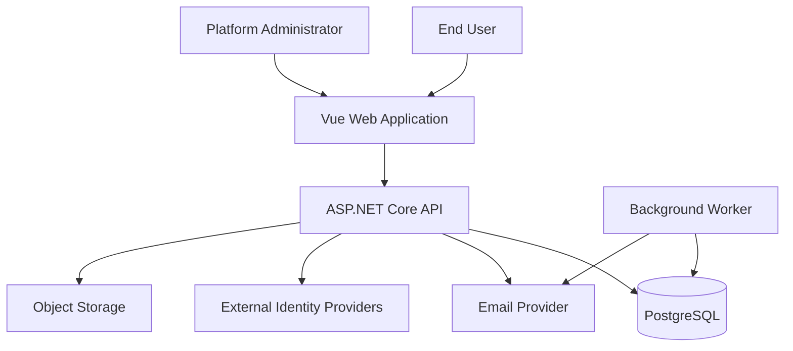
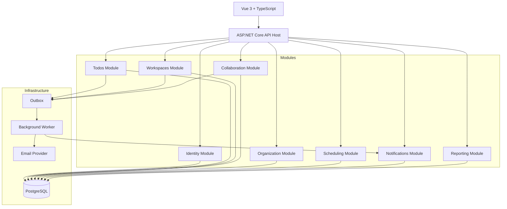
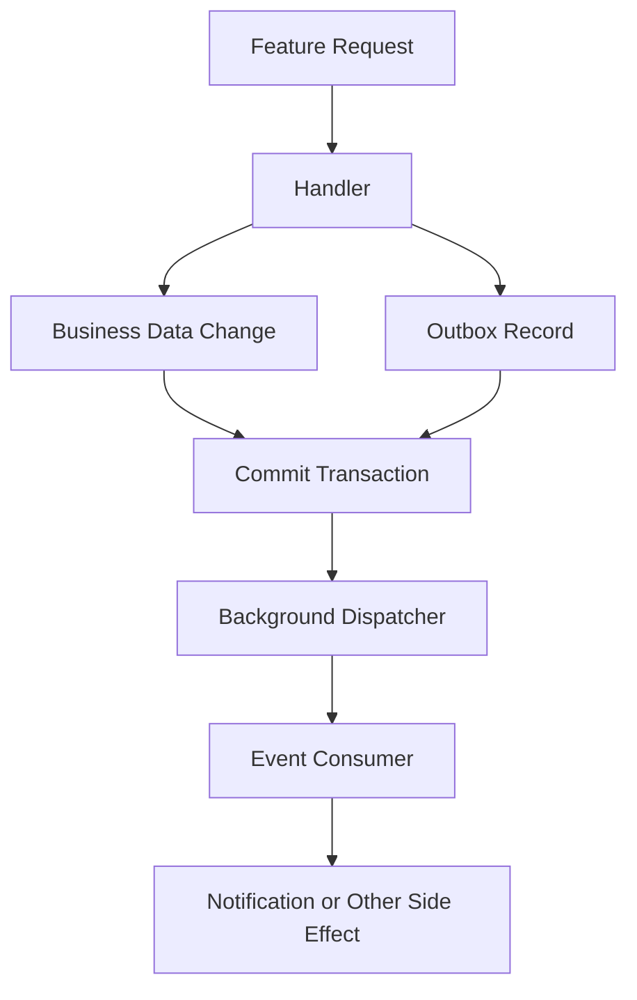
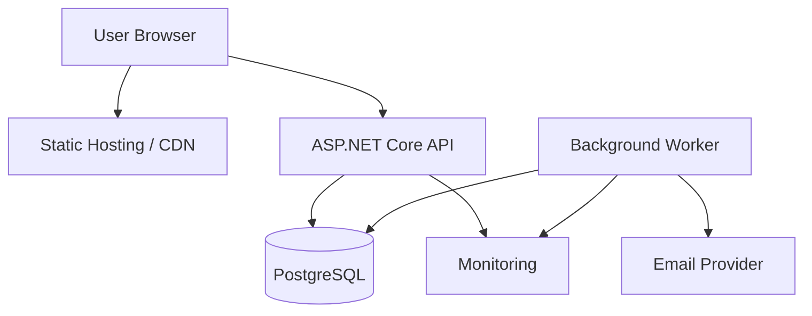

# SOLUTION ARCHITECTURE DOCUMENT (SAD)

## Todo & Team Collaboration Platform

| Property | Value |
|---|---|
| Document ID | SAD-TODO-001 |
| Version | 1.0 |
| Status | Draft |
| Related document | SRD-TODO-001 |
| Architecture | Modular Monolith |
| Design pattern | Vertical Slice Architecture |
| Backend | ASP.NET Core Web API |
| Frontend | Vue 3 + TypeScript |
| Database | PostgreSQL |
| ORM | Entity Framework Core |
| Authentication | ASP.NET Core Identity |

---

# 1. Introduction

## 1.1 Purpose

This document defines the technical architecture of the Todo and Team Collaboration Platform.

It translates business and functional requirements from the SRD into an implementable software architecture.

It defines:

- System architecture.
- Architectural principles.
- Module boundaries.
- Project structure.
- Domain ownership.
- Database architecture.
- API architecture.
- Authentication and authorization.
- Inter-module communication.
- Background processing.
- Frontend architecture.
- Security.
- Testing.
- Deployment.
- Architecture decisions.

## 1.2 Architecture Objectives

| ID | Objective |
|---|---|
| SAD-OBJ-001 | Maintain clear business module boundaries |
| SAD-OBJ-002 | Support independent feature development |
| SAD-OBJ-003 | Minimize coupling between modules |
| SAD-OBJ-004 | Support complete Identity functionality |
| SAD-OBJ-005 | Support personal and team task management |
| SAD-OBJ-006 | Ensure workspace-level authorization |
| SAD-OBJ-007 | Support reliable asynchronous processing |
| SAD-OBJ-008 | Support automated testing |
| SAD-OBJ-009 | Allow future scaling without premature microservices |

## 1.3 Architectural Principles

1. Business capabilities define modules.
2. Modules own their data.
3. Features are organized by use case.
4. Domain rules remain inside the owning module.
5. Cross-module communication uses explicit contracts.
6. Authentication and authorization are separate concerns.
7. All external input must be validated.
8. Background processing must be reliable and idempotent.
9. Security must be enforced on the backend.
10. Architecture boundaries must be verified through automated tests.

---

# 2. System Context

## 2.1 System Context Diagram



## 2.2 External Systems

| System | Purpose |
|---|---|
| Email Provider | Confirmation, password recovery, invitations and notifications |
| Google Identity | Optional external authentication |
| Microsoft Identity | Optional external authentication |
| PostgreSQL | Persistent application data |
| Object Storage | Optional avatars and attachments |
| Monitoring Platform | Logs, metrics and traces |

---

# 3. High-Level Architecture

## 3.1 Architecture Style

The application uses a Modular Monolith.

A single backend application hosts multiple independent business modules.

Each module contains its own:
- Features.
- Domain logic.
- Persistence.
- Contracts.
- Integrations.

Modules are deployed together but have explicit boundaries.

## 3.2 High-Level Component Diagram



## 3.3 Deployment Model

Initial deployment:

- One API application.
- One background worker application.
- One PostgreSQL database.
- One Vue frontend.
- One external email provider.

Do not deploy each business module separately.

---

# 4. Module Architecture

## 4.1 Module Catalogue

| Module | Responsibility | Data ownership |
|---|---|---|
| Identity | Accounts, authentication and security | Identity schema |
| Todos | Personal and workspace tasks | Todos schema |
| Workspaces | Workspaces, invitations and membership | Workspaces schema |
| Collaboration | Assignments, comments and activity | Collaboration schema |
| Organization | Categories and tags | Organization schema |
| Scheduling | Recurrence and reminders | Scheduling schema |
| Notifications | Email and in-app notifications | Notifications schema |
| Reporting | Dashboards and reporting projections | Reporting schema |

## 4.2 Identity Module

Responsibilities:

- User registration.
- Email confirmation.
- Login/logout.
- Password recovery.
- Password changes.
- MFA.
- External authentication.
- Account linking.
- Passkeys.
- Profile management.
- Session management.
- Security auditing.
- Account administration.

Technology:

- ASP.NET Core Identity.
- Identity EF Core stores.
- Cookie authentication.
- ASP.NET Core Data Protection.

Identity owns the user identity record and global platform roles.

Other modules reference users using UserId values. They must not directly modify Identity tables.

## 4.3 Todos Module

Responsibilities:

- Create todos.
- Update todos.
- Delete and restore todos.
- Complete and reopen todos.
- Retrieve todos.
- Search and filtering.
- Pagination.
- Subtasks.
- Todo lifecycle.

Important distinction:

Personal todos have no WorkspaceId.

Workspace todos have a WorkspaceId.

Both share the Todo domain but have different authorization rules.

## 4.4 Workspaces Module

Responsibilities:

- Workspace creation.
- Workspace updates.
- Workspace deletion and archiving.
- Workspace ownership.
- Membership.
- Invitations.
- Workspace roles.
- Membership validation.

Workspace roles:

- Owner.
- Admin.
- Member.
- Guest.

These are not ASP.NET Core Identity global roles.

## 4.5 Collaboration Module

Responsibilities:

- Assignments.
- Comments.
- Mentions.
- Watchers.
- Activity history.

The Collaboration module owns its own records.

It verifies workspace and task access through explicit module contracts.

## 4.6 Organization Module

Responsibilities:

- Categories.
- Tags.
- Todo categorization.
- Tag associations.

Personal categories and workspace categories should be distinguished by their scope.

## 4.7 Scheduling Module

Responsibilities:

- Recurrence rules.
- Reminder schedules.
- Next occurrence calculation.
- Time-zone handling.
- Scheduling job state.

Recurrence calculations must be deterministic and idempotent.

## 4.8 Notifications Module

Responsibilities:

- In-app notifications.
- Email notifications.
- Notification preferences.
- Email templates.
- Delivery status.
- Retry handling.

The Notifications module must not contain business rules for Todos or Workspaces.

## 4.9 Reporting Module

Responsibilities:

- Personal dashboard.
- Workspace dashboard.
- Task statistics.
- Completion trends.
- Overdue reports.
- CSV exports.

Reporting uses read projections rather than directly owning or modifying operational data.

---

# 5. Backend Solution Structure

## 5.1 Recommended Repository

```text
TodoApp/
│
├── src/
│   │
│   ├── Host/
│   │   └── Todo.Api/
│   │       ├── Program.cs
│   │       ├── DependencyInjection.cs
│   │       ├── Middleware/
│   │       └── Configuration/
│   │
│   ├── BuildingBlocks/
│   │   └── Todo.BuildingBlocks/
│   │       ├── Results/
│   │       ├── Messaging/
│   │       ├── Security/
│   │       ├── Persistence/
│   │       ├── Observability/
│   │       └── Time/
│   │
│   ├── Modules/
│   │   ├── Identity/
│   │   │   └── Todo.Modules.Identity/
│   │   ├── Todos/
│   │   │   └── Todo.Modules.Todos/
│   │   ├── Workspaces/
│   │   │   └── Todo.Modules.Workspaces/
│   │   ├── Collaboration/
│   │   │   └── Todo.Modules.Collaboration/
│   │   ├── Organization/
│   │   │   └── Todo.Modules.Organization/
│   │   ├── Scheduling/
│   │   │   └── Todo.Modules.Scheduling/
│   │   ├── Notifications/
│   │   │   └── Todo.Modules.Notifications/
│   │   └── Reporting/
│   │       └── Todo.Modules.Reporting/
│   │
│   └── Workers/
│       └── Todo.Worker/
│
├── tests/
│   ├── UnitTests/
│   ├── IntegrationTests/
│   ├── ArchitectureTests/
│   ├── SecurityTests/
│   └── EndToEndTests/
│
├── frontend/
│   └── todo-web/
│
├── deployment/
├── docs/
├── docker-compose.yml
└── TodoApp.sln
```

## 5.2 Module Internal Structure

Example: Todos module.

```text
Todo.Modules.Todos/
│
├── Features/
│   ├── CreateTodo/
│   ├── UpdateTodo/
│   ├── DeleteTodo/
│   ├── RestoreTodo/
│   ├── CompleteTodo/
│   ├── ReopenTodo/
│   ├── GetTodo/
│   ├── GetTodos/
│   ├── SearchTodos/
│   ├── CreateSubtask/
│   └── ReorderSubtasks/
│
├── Domain/
│   ├── TodoItem.cs
│   ├── Subtask.cs
│   ├── TodoStatus.cs
│   └── TodoPriority.cs
│
├── Persistence/
│   ├── TodosDbContext.cs
│   ├── Configurations/
│   └── Migrations/
│
├── Contracts/
│   ├── Events/
│   └── Queries/
│
├── Integrations/
│
└── TodosModule.cs
```

Features should own their request, handler, validation, endpoint and response.

Do not force every feature to implement every file if it does not need one.

## 5.3 Dependency Rules

Allowed:

- API Host → Module registration.
- Feature → Own module domain.
- Feature → Own module persistence.
- Module → BuildingBlocks.
- Module → Explicit public contracts from another module.

Not allowed:

- Todos → Direct access to WorkspacesDbContext.
- Collaboration → Direct access to TodosDbContext.
- Notifications → Direct access to IdentityDbContext.
- Reporting → Direct modification of operational module entities.

---

# 6. Vertical Slice Implementation Standard

## 6.1 Feature Example: CreateTodo

```text
Features/
└── CreateTodo/
    ├── Request.cs
    ├── Validator.cs
    ├── Handler.cs
    ├── Response.cs
    └── Endpoint.cs
```

## 6.2 Request

```csharp
public sealed record CreateTodoRequest(
    string Title,
    string? Description,
    DateTimeOffset? DueAt);
```

## 6.3 Response

```csharp
public sealed record CreateTodoResponse(
    Guid Id,
    string Title,
    string Status,
    DateTimeOffset CreatedAt);
```

## 6.4 Handler Responsibilities

The handler must:

1. Obtain the current authenticated user ID.
2. Validate business input.
3. Construct the Todo entity.
4. Apply business invariants.
5. Persist the entity.
6. Publish any required integration event through the outbox.
7. Return the response.

The handler must not accept OwnerUserId from an untrusted client request.

## 6.5 Endpoint

```http
POST /api/v1/todos
```

The endpoint:
- Requires authentication.
- Invokes the feature handler.
- Returns 201 Created.
- Uses consistent validation and error handling.

## 6.6 Validation

Use FluentValidation or equivalent validation.

Validate:
- Required fields.
- Maximum lengths.
- Allowed enum values.
- Date/time ranges.
- Cross-field requirements.

Business invariants must also be protected in the domain, not only in request validators.

---

# 7. Database Architecture

## 7.1 Database Strategy

Use one PostgreSQL database with separate module schemas.

Example:

```text
todo_app
│
├── identity
├── todos
├── workspaces
├── collaboration
├── organization
├── scheduling
├── notifications
└── reporting
```

Each module owns a separate DbContext and migrations.

This is logical isolation, not physical database isolation.

## 7.2 Identity Schema

Standard ASP.NET Core Identity entities:

- AspNetUsers
- AspNetRoles
- AspNetUserRoles
- AspNetUserClaims
- AspNetRoleClaims
- AspNetUserLogins
- AspNetUserTokens

Custom entities:
- UserSessions, if implementing application-managed sessions.
- SecurityAuditEvents.
- Passkey-related data through supported Identity functionality.

Use the framework's supported Identity schema and store configurations.

## 7.3 Todos Schema

Tables:

- TodoItems
- Subtasks

Important constraints:

- Todo title required.
- OwnerUserId required.
- WorkspaceId optional.
- Valid task status.
- Completion timestamp consistency.
- Optimistic concurrency.

## 7.4 Workspaces Schema

Tables:

- Workspaces.
- WorkspaceMembers.
- WorkspaceInvitations.

Important constraints:

- Unique active membership per user/workspace.
- Unique invitation token hash.
- Valid owner.
- Invitation expiration.
- Valid membership status.

## 7.5 Collaboration Schema

Tables:

- TodoAssignees.
- TodoComments.
- TodoWatchers.
- TodoActivities.

## 7.6 Organization Schema

Tables:

- Categories.
- Tags.
- TodoTags.

## 7.7 Scheduling Schema

Tables:

- RecurrenceRules.
- Reminders.
- ScheduledOccurrences.

## 7.8 Notifications Schema

Tables:

- Notifications.
- NotificationPreferences.
- EmailDeliveries.
- OutboxMessages.

## 7.9 Reporting Schema

Tables:

- UserTaskStatistics.
- WorkspaceTaskStatistics.
- DailyProductivityStatistics.

## 7.10 Cross-Module Relationships

Avoid cross-module EF Core navigation properties.

Use identifiers and contracts.

For example:

TodoItems contains WorkspaceId as a scalar value.

The Todos module validates that the workspace exists and is accessible using a Workspaces contract.

Where stronger relational integrity is required, define an explicit integration strategy rather than allowing arbitrary cross-module table ownership.

---

# 8. Module Communication

## 8.1 Communication Types

Two communication styles are supported.

### Synchronous Communication

Use when a feature needs an immediate answer.

Example:

Todos asks Workspaces whether the current user can create a task in a workspace.

Contract:

```csharp
public interface IWorkspaceAccess
{
    Task<bool> CanCreateTodoAsync(
        Guid workspaceId,
        Guid userId,
        CancellationToken cancellationToken);
}
```

### Asynchronous Communication

Use for side effects and workflows.

Example:

A user assigns a task.

The Collaboration module publishes:

```csharp
public sealed record TodoAssigned(
    Guid TodoId,
    Guid WorkspaceId,
    Guid AssigneeUserId,
    Guid AssignedByUserId);
```

The Notifications module consumes the event and creates a notification.

## 8.2 Outbox Pattern

Integration events must be saved in the same database transaction as the business operation.

Flow:



Requirements:

- Atomic business change and outbox record.
- Retry failed dispatch.
- Idempotent consumers.
- Event versioning.
- Dead-letter or operational failure handling.

For multiple DbContexts participating in one transaction, explicitly configure and test the shared transaction. Prefer a single owning module transaction for each business operation.

---

# 9. Identity and Security Architecture

## 9.1 Authentication Architecture

Use ASP.NET Core Identity with cookie authentication for the Vue browser application.

Recommended flow:

1. Vue submits credentials to the API.
2. API validates credentials using Identity.
3. Identity checks account status and lockout rules.
4. MFA is completed if required.
5. API issues a secure authentication cookie.
6. Browser sends the cookie with subsequent API requests.
7. API validates the cookie on every protected request.

## 9.2 Cookie Configuration

Production configuration:

- HTTPS only.
- HttpOnly.
- Secure.
- Appropriate SameSite policy.
- Appropriate cookie expiration.
- Sliding expiration according to security policy.
- Persistent Data Protection keys.

If the frontend and API are cross-origin, explicitly configure credentialed CORS and the appropriate cookie and antiforgery strategy.

## 9.3 CSRF Protection

Because authentication uses cookies:

- Implement antiforgery protection.
- Require antiforgery validation for state-changing requests.
- Do not rely on SameSite alone.
- Restrict CORS to trusted frontend origins.

## 9.4 Identity Feature Implementation

| Feature | Implementation |
|---|---|
| Registration | Identity UserManager |
| Login | SignInManager |
| Logout | SignInManager |
| Email verification | Identity token providers |
| Password recovery | Identity password reset tokens |
| Change password | UserManager |
| MFA | Identity two-factor APIs |
| Recovery codes | Identity two-factor recovery code APIs |
| External login | Identity external login APIs |
| Account linking | Identity external login stores |
| Passkeys | Supported Identity passkey functionality |
| Account lockout | Identity lockout configuration |
| Roles | Identity global roles |
| Claims | Identity claims |
| Security stamps | Identity security stamp validation |
| Sessions | Cookie authentication plus application-managed session tracking where required |

Use supported framework functionality before building custom authentication mechanisms.

## 9.5 Authorization

Separate global and workspace authorization.

Global authorization:

- PlatformAdministrator.
- SupportAdministrator.
- StandardUser.

Workspace authorization:

- Owner.
- Admin.
- Member.
- Guest.

Workspace permissions must be evaluated against the actual workspace and resource.

A user must not gain access to a workspace merely by possessing a global role.

## 9.6 Session Management

Identity cookie authentication does not automatically provide a complete list of individual devices.

For session inventory and per-device revocation, implement application-managed session records with:

- Session ID.
- User ID.
- Created timestamp.
- Last activity.
- Expiration.
- Revocation timestamp.
- Relevant device metadata.

Use a protected session identifier in the authentication ticket and validate the session during authentication.

Do not treat a browser user-agent string as reliable device identity.

---

# 10. API Architecture

## 10.1 API Standards

Base URL:

```text
/api/v1
```

Conventions:

- REST.
- JSON.
- OpenAPI.
- ProblemDetails.
- Pagination.
- Validation errors.
- Authorization.
- Correlation IDs.
- Cancellation tokens.

## 10.2 Endpoint Groups

| Module | Endpoint |
|---|---|
| Identity | /api/v1/identity |
| Authentication | /api/v1/auth |
| Profile | /api/v1/me |
| Todos | /api/v1/todos |
| Workspaces | /api/v1/workspaces |
| Collaboration | /api/v1/todos/{id}/comments |
| Organization | /api/v1/categories |
| Tags | /api/v1/tags |
| Scheduling | /api/v1/todos/{id}/reminders |
| Notifications | /api/v1/notifications |
| Reporting | /api/v1/dashboard |

## 10.3 Error Format

Use RFC 9457 Problem Details.

Example:

```json
{
  "type": "validation-error",
  "title": "Validation failed",
  "status": 400,
  "detail": "The request contains invalid fields."
}
```

---

# 11. Frontend Architecture

## 11.1 Technology

- Vue 3.
- TypeScript.
- Vite.
- Vue Router.
- Pinia.
- TanStack Vue Query.
- Vitest.
- Playwright.

## 11.2 Frontend Structure

```text
src/
│
├── app/
│   ├── main.ts
│   ├── router/
│   ├── layouts/
│   └── providers/
│
├── features/
│   ├── identity/
│   │   ├── api/
│   │   ├── pages/
│   │   ├── components/
│   │   ├── composables/
│   │   └── schemas/
│   │
│   ├── todos/
│   ├── workspaces/
│   ├── collaboration/
│   ├── organization/
│   ├── scheduling/
│   ├── notifications/
│   └── reporting/
│
└── shared/
    ├── api/
    ├── components/
    ├── composables/
    ├── types/
    └── utils/
```

## 11.3 State Management

Use Pinia for:

- Current user.
- Active workspace.
- UI preferences.
- Navigation state.

Use TanStack Vue Query for:

- API data.
- Server state.
- Cache invalidation.
- Pagination.
- Query synchronization.

Avoid duplicating server state unnecessarily in Pinia.

## 11.4 Authentication State

The frontend must not store authentication cookies or passwords in JavaScript-accessible storage.

Use:

- HTTP-only cookie.
- API current-user endpoint.
- Query cache for user information.
- Router guards for navigation experience.

Backend authorization remains authoritative.

---

# 12. Background Processing

## 12.1 Worker Responsibilities

- Outbox dispatch.
- Email delivery.
- Reminder execution.
- Recurrence generation.
- Expired invitation cleanup.
- Expired session cleanup.
- Data retention jobs.

## 12.2 Reliability

Background jobs must support:

- Retry.
- Idempotency.
- Locking or claiming.
- Concurrency control.
- Monitoring.
- Failure visibility.

For multiple worker instances, use PostgreSQL-backed claiming with appropriate locking, or a durable job processing system.

---

# 13. Security Architecture

Security controls include:

- HTTPS.
- Identity password hashing.
- MFA.
- Cookie security.
- CSRF protection.
- CORS restrictions.
- Rate limiting.
- Input validation.
- Resource authorization.
- Secure secrets.
- Audit logs.
- Dependency scanning.
- Database least privilege.
- Backup encryption.

Security testing must include cross-user and cross-workspace access attempts.

---

# 14. Observability

Use OpenTelemetry for:

- Structured logs.
- Distributed traces.
- Metrics.
- HTTP request monitoring.
- Database performance.
- Background job performance.

Important metrics:

- API error rate.
- API latency.
- Authentication failures.
- Account lockouts.
- Pending outbox messages.
- Failed email deliveries.
- Overdue background jobs.
- Database connection utilization.

Do not log passwords, tokens, session secrets or sensitive authentication payloads.

---

# 15. Testing Architecture

| Test type | Purpose | Tools |
|---|---|---|
| Unit | Domain and handler logic | xUnit |
| Integration | API and database | WebApplicationFactory |
| Database | PostgreSQL behavior | Testcontainers |
| Architecture | Module boundaries | NetArchTest or equivalent |
| Security | Authorization and authentication | Integration test suites |
| Frontend unit | Components and composables | Vitest |
| E2E | User workflows | Playwright |
| Performance | Throughput and latency | k6 |

## 15.1 Mandatory Architecture Tests

Verify:

- Modules cannot access another module's internal types.
- Modules cannot reference another module's DbContext.
- Public contracts are the only permitted integration boundary.
- BuildingBlocks contains no business-specific dependencies.
- API Host is the composition root.

---

# 16. Deployment Architecture

## 16.1 Initial Infrastructure



## 16.2 Environments

- Local.
- Development.
- QA.
- Staging.
- Production.

## 16.3 Deployment Requirements

- Docker images.
- CI/CD pipeline.
- Automated tests.
- Database migration job.
- Secret management.
- Health checks.
- Rollback strategy.
- Database backup.
- Monitoring.

Run migrations as a controlled deployment step, not automatically from every application instance at startup.

---

# 17. Architecture Decision Records

| ADR | Decision | Reason |
|---|---|---|
| ADR-001 | Modular Monolith | Avoid premature distributed-system complexity |
| ADR-002 | Vertical Slice Architecture | Organize around business use cases |
| ADR-003 | PostgreSQL | Relational persistence and transaction support |
| ADR-004 | EF Core | .NET data access |
| ADR-005 | ASP.NET Core Identity | Complete account and authentication functionality |
| ADR-006 | Cookie Authentication | Browser-based SPA security |
| ADR-007 | Module-owned DbContexts | Data ownership |
| ADR-008 | Outbox Pattern | Reliable integration events |
| ADR-009 | Vue 3 + TypeScript | Frontend platform |
| ADR-010 | Background Worker | Asynchronous processing |
| ADR-011 | Shared Database, Separate Schemas | Initial operational simplicity |
| ADR-012 | Contract-based Module Integration | Minimize coupling |

---

# 18. Architecture Acceptance Criteria

The architecture is approved when:

1. Every business module has explicit ownership.
2. Each module has an independent DbContext.
3. Module boundaries are enforced by tests.
4. Cross-module access uses explicit contracts.
5. Identity is configured using supported ASP.NET Core Identity functionality.
6. Cookie and CSRF protection are implemented.
7. Workspace authorization is resource-specific.
8. Background processing is idempotent.
9. Outbox processing is reliable.
10. Database migrations are controlled.
11. Frontend features are organized by business capability.
12. Automated tests cover critical architecture and security boundaries.
13. Deployment and recovery procedures are documented.

---

# 19. Architecture Approval

| Role | Status |
|---|---|
| Product Owner | Pending |
| Business Analyst | Pending |
| Solution Architect | Pending |
| Backend Lead | Pending |
| Frontend Lead | Pending |
| QA Lead | Pending |
| DevOps Lead | Pending |

**End of Solution Architecture Document.**